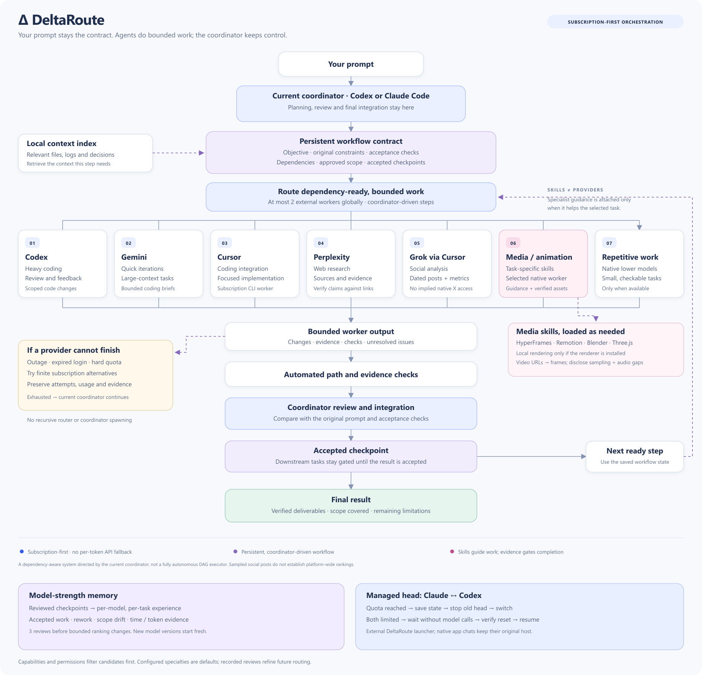

# DeltaRoute (Δ)

DeltaRoute coordinates local AI subscription clients from **Claude Code or Codex**. Your current host plans and reviews; bounded workers handle suitable tasks through their own signed-in clients. Long jobs run as an Operation Plan the user approves first: routes with token budgets, agents and cheap sub-agents, a 0-100 Review (80 passes), a simulated review of the whole product and the user's final approval, all streamed to a live local dashboard. A capability registry gives each role to the best available model. See [docs/ARCHITECTURE.md](docs/ARCHITECTURE.md).



**Windows is the supported installation target.** The Node core also has portable tests; macOS/Linux native integrations require manual configuration and are not claimed as fully validated. Bring your own eligible subscriptions and official clients. The project supplies no accounts, provider binaries or API credits.

## Install

Install Node.js 22+, Git, Python 3.11+, and the official Claude Code and/or Codex CLI. Install any additional provider clients you intend to use, then sign in through each client's normal account flow. Subscription eligibility and available models depend on the provider and account. Never copy someone else's credentials.

```powershell
git clone https://github.com/olivergoldberg15-bit/DeltaRoute.git
cd DeltaRoute
powershell -NoProfile -ExecutionPolicy Bypass -File .\setup.ps1
npm test
```

Setup creates a private local `config.json`, discovers compatible installed executables and leaves missing providers disabled. Review that file before enabling additional workers. `config.example.json` explains the configurable transports. There are no npm runtime dependencies to install.

Register the clients you use:

```powershell
# Claude Code: global routing policy, prompt hook, MCP and repetitive subagent
powershell -NoProfile -ExecutionPolicy Bypass -File .\install.ps1 -AllowRouterTools

# Codex: global routing policy, native skill and MCP
powershell -NoProfile -ExecutionPolicy Bypass -File .\install-codex.ps1 -ManagedHeads

powershell -NoProfile -ExecutionPolicy Bypass -File .\doctor.ps1
```

The switches opt into approval for the six local router tools. They do not grant blanket shell/browser permissions or override explicit Codex denials. Without the switches, worker submission/cancellation use normal approvals; the Codex installer may approve its read-only router tools. Installers back up changed global files and refuse to overwrite an unrelated existing MCP registration. Keep this checkout at its installed path and restart the host to load changes.

See [setup and providers](docs/SETUP.md) for prerequisites, sign-in, research, video tools, optional skills, manual MCP setup and troubleshooting.

On Linux or macOS, `node install-claude.mjs --allow-router-tools` does what `install.ps1 -AllowRouterTools` does. To run DeltaRoute on an always-on cloud server and drive it from the Claude app on a phone, see [DeltaRoute in the cloud](docs/CLOUD.md).

## What routes where

| Work | Default role |
|---|---|
| Planning, creative direction, review, integration | Current Claude Code/Codex host |
| Implementation, debugging, tests, independent feedback | Codex |
| Quick coding, iteration, large context | Configured Google CLI / Gemini |
| Frontend and integration | Cursor |
| Cited web research | Perplexity through gstack, or original public sources |
| Social source analysis | Grok through Cursor, using collected original posts |
| Repetitive read-only work | Claude's native Haiku subagent, when available |
| Animation, 3D, realism, context and verification | Relevant specialist instructions, loaded on demand |

These are editable starting specialties. Availability and capabilities filter the choices. Explicit checkpoint reviews build memory by **exact model and task category**; three reviews are required before bounded ranking adjustments apply. Pin explicit model IDs for version-specific comparisons; an account-default alias can change underneath its stored feedback. This is local feedback, not an independently proven model leaderboard.

Small self-contained tasks stay local because worker startup and repeated context can cost more than they save. Routing is a host policy and tool workflow, not an interceptor that guarantees every chat launches a worker.

## Long work and recovery

Save the original prompt as a workflow with constraints, non-goals, dependencies, allowed paths and acceptance checks. Workers use pinned Git worktrees. The coordinator reviews real evidence before releasing dependent steps. Failed attempts and counters remain available. Two external workers may run at once; heavy profiles allow bounded 30-minute attempts.

An external supervisor can replace a stopped Claude head with Codex, or vice versa, for a **managed workflow**. If both heads reach hard quotas, new work waits for verified recovery. Native app chats keep their own host.

```powershell
.\DeltaRoute.ps1 -WorkflowId "<saved-workflow-UUID>" -Background
```

Worker outages, expired logins and quotas use finite fallbacks and cooldowns. Exhausted workers hand back to the current coordinator. Login challenges, unconfirmed process shutdown and unresolved approval needs preserve state and require attention. No system can guarantee availability when all accounts or services are unavailable. There is no paid API fallback or quota bypass.

Details: [heavy workflows](HEAVY-WORKFLOWS.md), [MCP examples](deltaroute-skill/references/heavy-workflows.md), [architecture](docs/ARCHITECTURE.md), [editable chart](docs/deltaroute-routing.mmd).

## Video, social evidence and quality

Video URL analysis extracts actual sampled frames with local yt-dlp/FFmpeg and attaches them to a configured vision-capable Codex worker. Default coverage is eight frames from the first 60 seconds. Longer videos use explicit bounded windows. Native captions are retained; missing audio remains unverified.

Social research retains original URLs, publication/retrieval times and available metrics. Missing dates/counts remain unknown. A few posts do not establish a platform-wide trend. Grok through Cursor does not establish privileged live X access. Browser pages and public extraction can change or require login.

Specialist guidance covers Three.js, Blender, Remotion, creative work, context efficiency and verification. Licensing, pinned sources and installation are documented in [third-party notices](THIRD_PARTY_NOTICES.md) and [the skill manifest](skills-manifest.json). Some upstream collections have no redistribution license and are not bundled; the notices explain the optional explicit download path. Skills do not install a renderer, prove photorealism or automatically authorize cloud uploads and purchases.

## Tests, speed and cost

```powershell
npm test
npm run test:process
npm run test:install
npm run usage
npm run skills:verify
```

The default tests use local fixtures without provider calls or account resets. Process fault tests require Windows and Git; see [test and benchmark instructions](benchmarks/README.md).

One historical matched log experiment reduced Claude logical input from 89,908 to 9,489 tokens. Tiny forced delegation used substantially more context than direct work. A separate managed head/worker fixture took 40.252 seconds. These are observations from individual trials, not universal speed or savings claims. Cached reads are a subset of input; browser counters may be unavailable. Fixed monthly subscription bills remain unchanged. See [verification and measurement limits](verification.md).

## Project files

- `server.mjs`: six MCP tools and bounded worker adapters.
- `workflows.mjs`: original contract, dependency gates and scope audits.
- `coordinator-supervisor.mjs`: external managed-head lifecycle.
- `coordinator-state.mjs`, `account-limits.mjs`: observed quota state and native readiness.
- `routing-memory.mjs`: explicit reviewed task-fit feedback.
- `media-evidence.mjs`, `browser.mjs`: sampled video and sourced research.
- `telemetry.mjs`, `usage-report.mjs`: native counters, compact results and retained attempts.
- `deltaroute-skill/`: host instructions and on-demand references.

Original DeltaRoute code is MIT licensed. Third-party materials retain their own licenses. Local account data, prompts, caches and session logs are excluded from the release; see [SECURITY.md](SECURITY.md).
