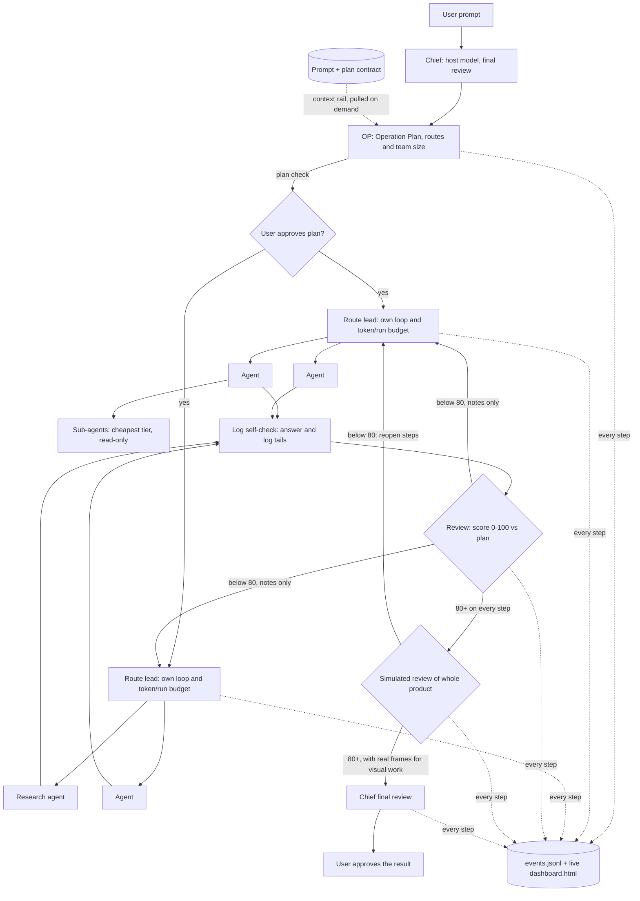

# Architecture and workflow

The host conversation is Chief. It receives the prompt, plans, reviews and integrates. A
Claude prompt hook repeats a short policy without storing the prompt. Workers get scoped briefs
that point at the saved contract, and a recursion guard; the host remains responsible for the
final answer. Every role below Chief goes to the best available model in the capability
registry (`models.json`), whose tier allows it.

## The six MCP tools

| Tool | Purpose |
|---|---|
| `list_workers` | Compact installation, cooldown, model and optional usage state |
| `recommend_route` | Capability-aware specialties, reviewed fit and relevant skill paths |
| `submit_task` | Delegate or create/run/checkpoint a persistent workflow |
| `get_task` | Read compact results or saved workflow status; optional bounded wait |
| `cancel_task` | Stop a job and its children while retaining evidence |
| `model_registry` | Role assignment from capability scores; refresh live model lists into proposals that only the user's quoted approval applies |

Transport is line-delimited JSON-RPC over stdio. `node server.mjs --call
list_workers '{}'` is a local diagnostic interface. The server has no public
HTTP listener, mock API key or subscription-cookie proxy.

## Contracts and coding isolation

Workflow plans save the original prompt, objective, constraints, non-goals,
acceptance criteria, relative allowed paths, dependencies and finite budgets.
Assignments derive from the saved step rather than arbitrary run-time overrides.

Coding jobs require a clean Git project. Each attempt gets a separate worktree
from the pinned accepted HEAD, including fallback attempts. Coding review uses
the pinned tree too. Tracked and untracked path audits reject scope drift.
This file audit is not an OS sandbox: native CLI sandbox policy and coordinator
review still matter. Workers never merge, push or deploy.

Completed output does not release dependencies. A coordinator checkpoint must
record evidence for each acceptance criterion. Accepted code must be integrated,
checked and committed in a clean project checkout. Downstream launch validates
all transitive accepted code prerequisites. A coordinator-completed recovery is
recorded separately and does not give quality credit to the failed worker.

## Operation Plan, budgets and review

`create_workflow` saves an Operation Plan: routes (each with a lead and a budget), steps (one agent
each, optionally naming a provider and registry model) and up to six read-only sub-agents per step.
New plans wait for `approve_plan`, which records the user's own words. A route's budget counts
fresh input plus output tokens (cached reads are reported but not budgeted) with a run count as the
backup, so workers that report no tokens are still bounded. When a route runs out it stops and lists
what went wrong.

Each finished attempt gets a log self-check: an empty answer or an admitted failure blocks
acceptance until the reviewer explains the resolution; tracebacks, crashes and test failures in the
logs are warnings. Review scores each step 0-100 against the approved plan; 80 passes and anything
lower goes back to that step with only the reviewer's notes and score. Once every step passes,
`simulated_review` judges the whole product from evidence of what was actually run. Visual work
needs real frame or screenshot files to pass, because workers never see their renders. A failing
simulated review reopens the named steps and everything built on them. `final_review` records
Chief's note and then the user's approval; only then is the workflow done.

Every change is appended to `workflows/<id>/events.jsonl` and redrawn into
`workflows/<id>/dashboard.html`, a static page that refreshes itself every few seconds until the
run is done. There is no server and nothing opens a window. Token counts there cover workers only;
the host's own tokens as Chief and reviewer are not measured.

## Honest failures and the smoke test

A code job that changes no files counts as failed and falls back to the next provider. A dirty
checkout is refused before a job exists, so it never uses up a step's try. Google's robot check is
reported as a bot check. `npm run smoke` launches each enabled code worker on a tiny job and
confirms a file changed; unit tests never launch a worker.

## Worker fallback and managed heads

Worker errors are classified as authentication, quota, outage, timeout, challenge
or non-provider failures. Eligible account-authenticated workers have bounded
attempts and shared-account cooldowns. Scope/input/safety failures are not retried
through a more permissive provider. If attempts exhaust, the current host resumes
from saved artifacts. Unconfirmed process termination blocks workspace edits.

Managed head replacement is a separate external supervisor. Ownership leases
prevent duplicate heads for a workflow/project. It saves native session IDs,
verifies the old head and workers have stopped, then can switch Claude to Codex
or Codex to Claude on observed hard quota signals. Workers and heads do not
recursively launch coordinators.

If both heads are limited, new work pauses. Absolute reset times schedule checks
or one bounded probe; elapsed time alone does not prove recovery. Codex's native
account readiness can be checked without a model request. Unknown values stay
unknown. There is no API-key fallback, reset-credit redemption or overage purchase.
Ordinary desktop chats retain their host; only managed runs use replacement.

## Memory, context and evidence

Routing memory contains explicit coordinator reviews, exact configured model,
task category, timestamps, outcome, scope violations and available counters.
Three matching reviews are required before a bounded adjustment can change the
default ordering. It stores no raw prompt, but job/workflow files do contain
the assignment and should remain private.

The prompt hook and worker briefs supply short hints. Specialist bodies load
only when relevant. Hash checks prevent silently selecting changed entry files.
Optional context-mode integration exposes only local execution/index/search and
diagnostics, with URL fetch/purge/upgrade excluded. All browsing uses gstack.

Video analysis samples actual frames and native captions. Social research
preserves source URLs and dates/metrics where available. Source text is untrusted
evidence, never an instruction to the worker. Sparse frames do not establish
continuous coverage; source analysis does not establish comprehensive live X
access or a platform-wide trend ranking.

Native token counters are retained per attempt, including failures, and summarized
without replaying whole prompts and raw research packets. Unknown counters stay
unknown. Fixed subscription cost, cached input and provider quota weighting are
separate quantities.
